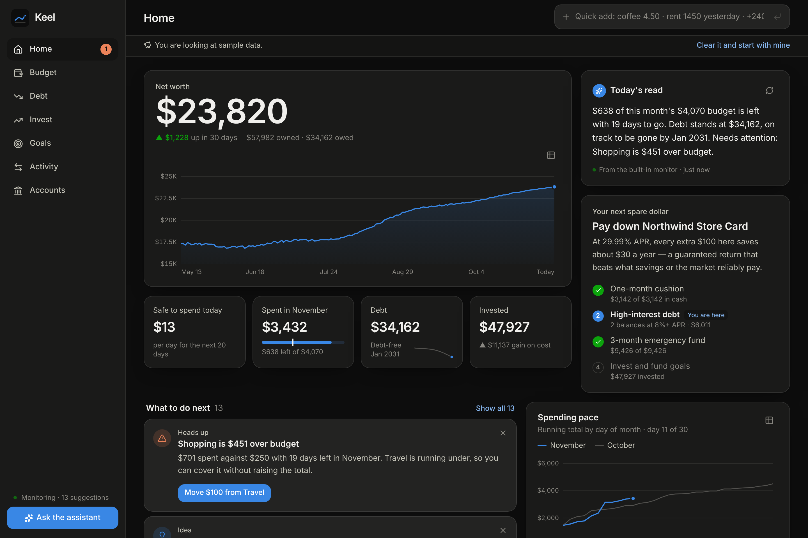
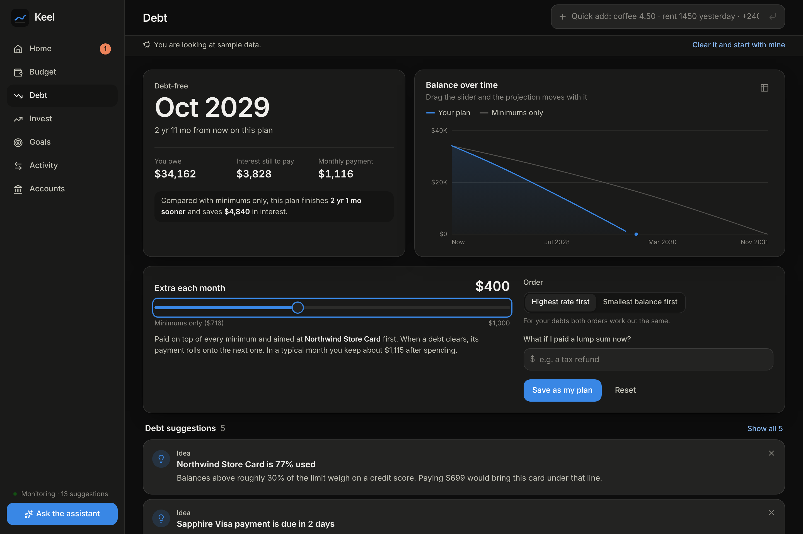
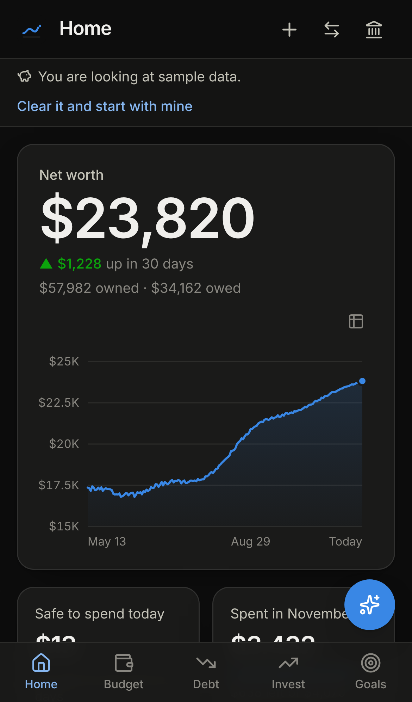

# Keel

A personal finance app for one person: budget, debt payoff, investments and savings in one place, with a monitor that watches your numbers and suggests changes you can apply with one tap.

It runs on your own computer, stores everything in a local file, and works in the browser on a PC or a phone.



| Debt planner — drag the slider and the projection moves | On a phone |
| --- | --- |
|  |  |

## What it does

- **Home** — net worth with its trend, a short written read of where you stand, the best use of your next spare dollar, and the suggestions that matter most right now.
- **Budget** — what is left this month and what is safe to spend today, per-category meters you can edit in place, a budget built from your own spending history in one tap, and recurring charges detected from your transactions.
- **Debt** — every card and loan in payoff order, your debt-free date, and a live planner: move the extra-payment slider, switch between highest-rate-first and smallest-balance-first, or try a lump sum, and the projection updates as you drag.
- **Invest** — holdings across accounts, allocation against a target mix you set, gain on cost, and price refresh for tickers.
- **Goals** — savings goals with projected finish dates. Link a goal to an account and it tracks itself.
- **Activity** — every transaction, searchable and filterable, with one-line quick entry.
- **Assistant** — a chat panel backed by Claude that can read everything in the app, run the numbers, and make changes when you ask. It also writes the home-screen briefing and files its own suggestions.

## Getting started

You need [Node.js 22 or newer](https://nodejs.org).

```bash
npm install
npm run build
npm start
```

Open <http://localhost:8787>. With nothing configured you can already add accounts by hand, import statements, or tap **Explore with sample data** to look around.

To turn on bank linking and the assistant, copy `.env.example` to `.env`, fill in the keys described below, and restart.

For development, `npm run dev` runs the API and a hot-reloading web app at <http://localhost:5173>.

## Getting your data in with little typing

Use whichever is least work; they can be mixed.

1. **Link accounts (Plaid).** Balances, transactions, card and loan rates, minimum payments, due dates and investment holdings sync automatically, on a schedule and whenever you tap *Sync now*.
2. **Tell the assistant.** "I have a Visa with $4,200 at 24.99%, minimum $95, and a car loan of $9,700 at 7.4%" creates both debts. You can also attach a statement PDF, a screenshot or a spreadsheet and it records what it can read.
3. **Import a CSV.** Drop in any bank or card export. Columns and sign conventions are detected and previewed first, categories are filled in, and re-importing an overlapping file does not double count.
4. **Quick add.** Type `coffee 4.50`, `rent 1450 yesterday` or `+2400 paycheck 11/1` and press Enter.

When you correct a category you can tick *Always file this merchant this way*; the rule applies to history and to everything imported later.

### Setting up Plaid

1. Create an account at <https://dashboard.plaid.com> and copy your **client ID** and **sandbox secret** from *Developers → Keys*.
2. Put them in `.env` as `PLAID_CLIENT_ID` and `PLAID_SECRET`, with `PLAID_ENV=sandbox`.
3. Restart Keel, go to **Accounts**, and link a test bank. Plaid's sandbox login is `user_good` / `pass_good`.
4. For your real accounts, request production access in the Plaid dashboard, then switch to the production secret and `PLAID_ENV=production`. Banks that sign in through their own site (OAuth) also need `PLAID_REDIRECT_URI` set to an HTTPS address registered with Plaid. Check Plaid's current pricing before linking; production use is billed by them, not by this app.

Keel asks for transactions, liabilities and investments. Where an institution does not offer one of these, the rest still syncs.

### Setting up the assistant

Put an Anthropic API key in `.env` as `ANTHROPIC_API_KEY` (from <https://platform.claude.com>). The model defaults to `claude-opus-5-5`; set `ANTHROPIC_MODEL` to change it.

Without a key the chat panel is off, but the built-in monitor still runs and still posts suggestions.

## How the monitoring works

Every time data changes — a sync, an import, an entry, a setting — and a few times a day regardless, Keel re-checks your finances and updates the suggestion list. Open screens refresh immediately, on every device, and urgent findings appear as a notification banner.

The built-in checks need no AI and no network:

- **Budget:** categories over budget (with an offer to cover the gap from one that is running under), categories on pace to overshoot, a starter budget from your history, subscription price rises, the total cost of your subscriptions, unusually large purchases.
- **Cash:** checking balance too low for the recurring charges due in the next ten days; spending more than you earn.
- **Debt:** a minimum payment that does not cover the interest, high card utilisation, payments due soon, how much sooner a larger extra payment gets you out of debt, when highest-rate-first would be cheaper, idle cash that would do more against an expensive balance.
- **Savings:** emergency fund coverage in months, goals falling behind their target date, goals reached.
- **Investments:** drift from your target mix, a single holding making up a fifth or more of the portfolio, uninvested cash.

Where a finding has an obvious fix, the card carries a button that makes the change. Dismissed suggestions stay dismissed; ones whose cause goes away disappear on their own.

With the assistant enabled, Claude also reviews the picture after changes (at most every six hours), adds suggestions the fixed rules would miss, and writes the briefing at the top of the home screen.

**Your next spare dollar** follows a common ordering: a one-month cushion, then debt at 8% APR or more, then a full emergency fund, then investing and goals.

## Using it on your phone

By default Keel only answers on the computer it runs on. To reach it from a phone on the same Wi-Fi, set both of these in `.env` and restart:

```
HOST=0.0.0.0
APP_PASSWORD=choose-something-long
```

Then open `http://<your-computer's-IP>:8787` on the phone. Keel refuses to listen on the network without a password.

The app is installable (Add to Home Screen) and laid out for small screens. Full install on Android, and Plaid's bank sign-in from the phone, need HTTPS; the simplest ways to get that on a private network are [Tailscale Serve](https://tailscale.com/kb/1312/serve) or a Cloudflare Tunnel in front of port 8787. Linking accounts from the PC and viewing on the phone works without any of that.

## Your data

- Everything is stored in `data/keel.db` (SQLite) next to the app. Back up that file to back up Keel. The folder is ignored by git.
- Plaid access tokens are stored in that database. Set `DATA_ENCRYPTION_KEY` in `.env` to encrypt them at rest; keep the key, because connections saved with it cannot sync without it.
- Nothing leaves your machine except: calls to Plaid for linked accounts, price lookups for the tickers you hold, and — when the assistant is on — your chat messages, anything you attach, and the account data the assistant looks up, which go to Anthropic's API.
- **Accounts → Erase everything** removes all data and disconnects linked institutions.

## What has and has not been verified

Checked in a real browser at desktop and phone sizes, in light and dark themes: adding accounts by hand, sample data, quick add, applying suggestions, the live debt planner, chart tooltips and table views, in-place budget edits, goals, search and category rules, CSV import, the target-mix editor, live updates across two open tabs, the password gate and the network guard. `npm test` covers the payoff maths, entry parsing, categorisation, the monitor rules, de-duplication, CSV parsing, and the assistant's tool loop.

Not exercised against the live services, because the environment this was built in had no credentials for them and could not reach some of them:

- **Plaid.** The link and sync code is written against Plaid's official SDK and type-checks, but has not been run against Plaid. Try the sandbox first.
- **The Anthropic API.** The assistant is tested end to end against a local stand-in using the real SDK, which covers streaming, tool calls and persistence, but not a live model.
- **Price quotes.** Stock prices come from Stooq's public CSV endpoint (or Finnhub if `FINNHUB_API_KEY` is set) and crypto from CoinGecko. If a lookup fails the last known price is kept.

## Project layout

```
shared/    types, categories, the payoff simulator, quick-entry parser (used by both sides)
server/    Express API, SQLite storage, monitor rules, Plaid sync, quotes, the assistant
src/       React web app: pages, charts, forms
tests/     unit and integration tests
```

Useful commands: `npm run dev`, `npm run build`, `npm start`, `npm test`, `npm run typecheck`.

## A note on advice

Keel does arithmetic on your own numbers and applies widely used rules of thumb. It is not a licensed adviser, and the assistant's answers are general guidance. For tax, legal or large investment decisions, talk to a professional.
